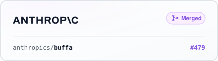
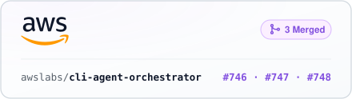
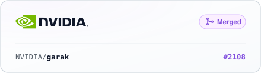
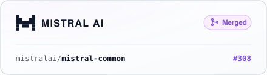
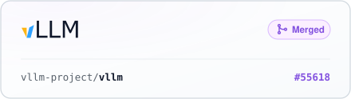
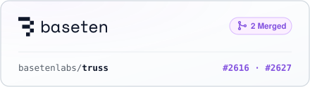
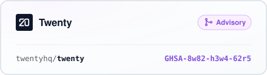
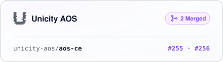
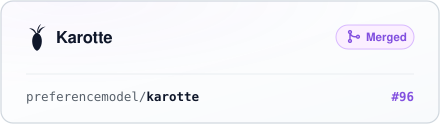
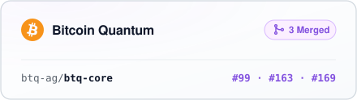

  <a href="https://github.com/anthropics/buffa/pull/479"><picture><source media="(prefers-color-scheme: dark)" srcset="./assets/anthropic-dark.svg"></picture></a>
  <a href="https://github.com/awslabs/cli-agent-orchestrator/pulls?q=is%3Apr+author%3AOskii+is%3Amerged"><picture><source media="(prefers-color-scheme: dark)" srcset="./assets/aws-dark.svg"></picture></a>

  <a href="https://github.com/NVIDIA/garak/pull/2108"><picture><source media="(prefers-color-scheme: dark)" srcset="./assets/nvidia-dark.svg"></picture></a>
  <a href="https://github.com/mistralai/mistral-common/pull/308"><picture><source media="(prefers-color-scheme: dark)" srcset="./assets/mistral-dark.svg"></picture></a>

  <a href="https://github.com/vllm-project/vllm/pull/55618"><picture><source media="(prefers-color-scheme: dark)" srcset="./assets/vllm-dark.svg"></picture></a>
  <a href="https://github.com/basetenlabs/truss/pull/2616"><picture><source media="(prefers-color-scheme: dark)" srcset="./assets/baseten-dark.svg"></picture></a>

  <a href="https://github.com/twentyhq/twenty/security/advisories/GHSA-8w82-h3w4-62r5"><picture><source media="(prefers-color-scheme: dark)" srcset="./assets/twenty-dark.svg"></picture></a>
  <a href="https://github.com/unicity-aos/aos-ce/pulls?q=is%3Apr+author%3AOskii+is%3Amerged"><picture><source media="(prefers-color-scheme: dark)" srcset="./assets/unicity-dark.svg"></picture></a>

  <a href="https://github.com/preferencemodel/karotte/pull/96"><picture><source media="(prefers-color-scheme: dark)" srcset="./assets/karotte-dark.svg"></picture></a>
  <a href="https://github.com/btq-ag/btq-core/pulls?q=is%3Apr+author%3AOskii+is%3Amerged"><picture><source media="(prefers-color-scheme: dark)" srcset="./assets/btq-dark.svg"></picture></a>

